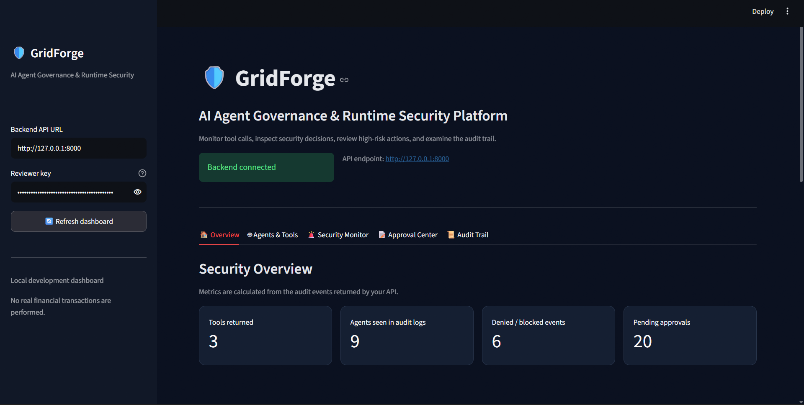
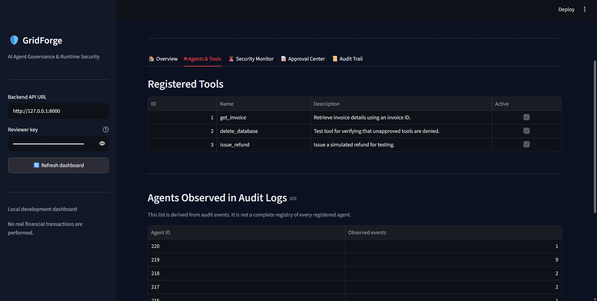
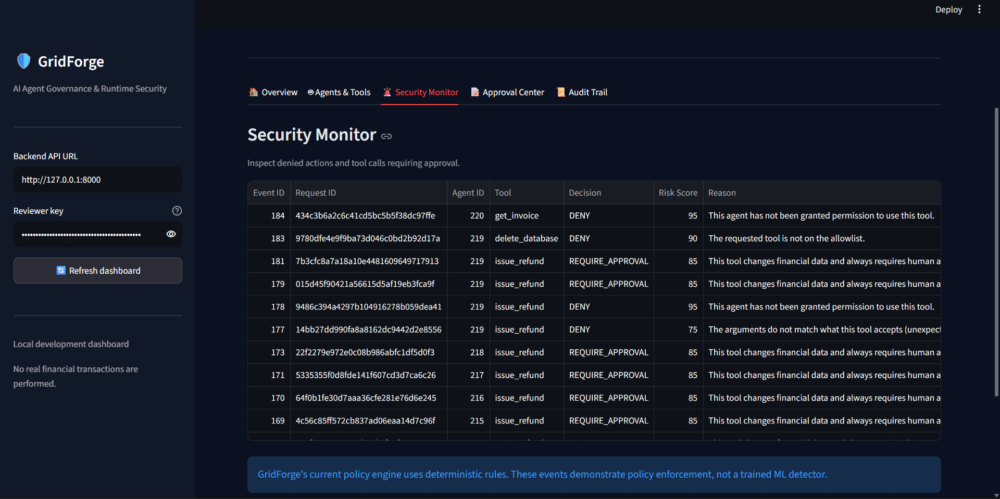
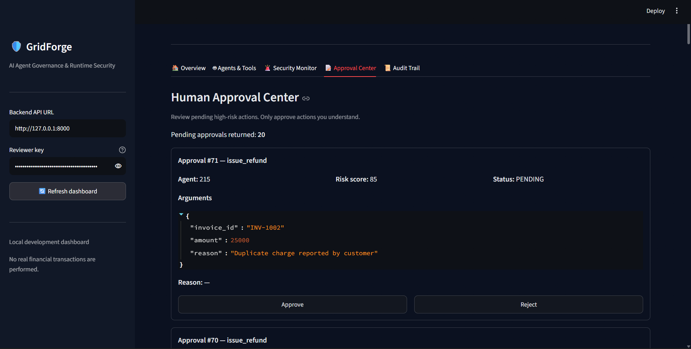
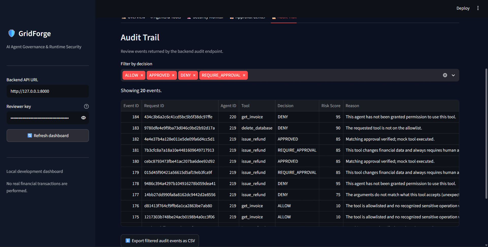
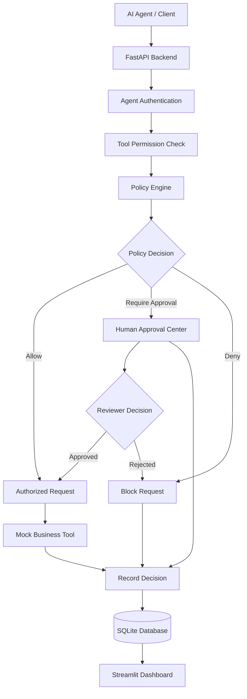
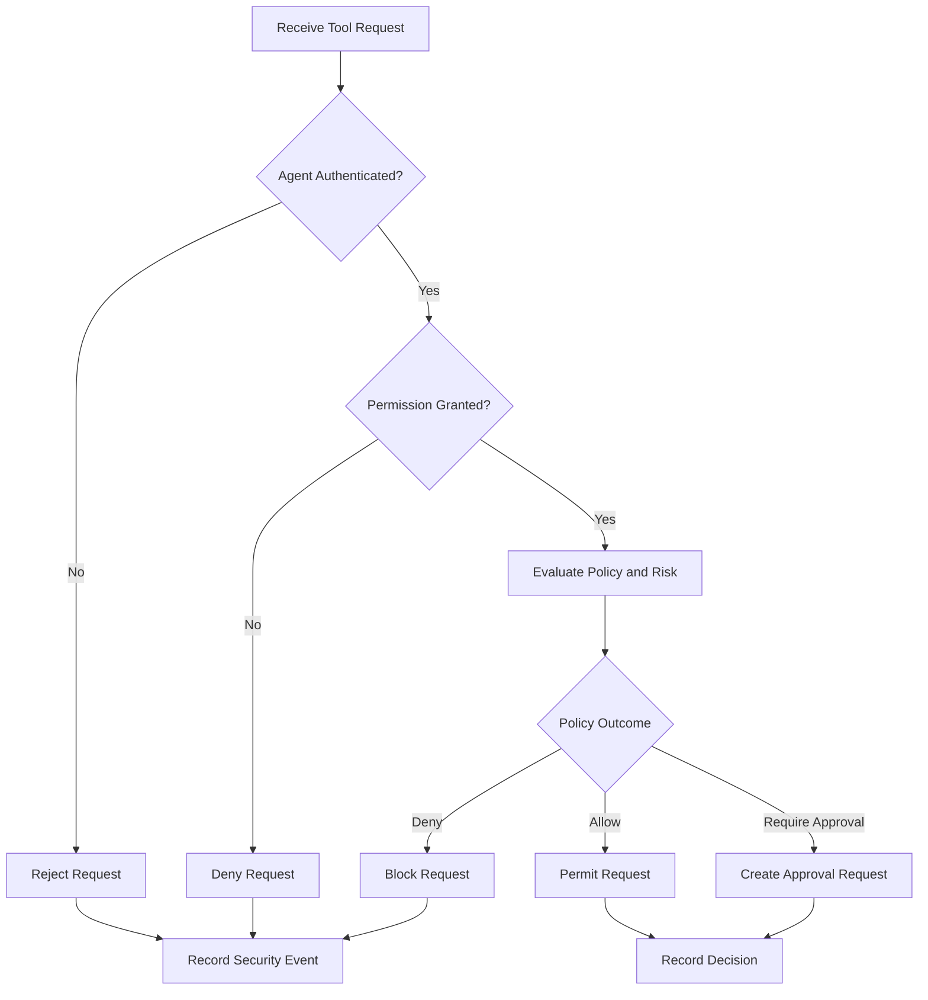

# GridForge
### AI Agent Governance & Runtime Security

**A policy enforcement and security layer for AI agents interacting with business tools.**

GridForge is a prototype of an AI agent governance platform designed to help organizations control what AI agents can do, detect risky tool usage, require human approval for sensitive actions, and maintain an audit trail of decisions.

As AI agents gain the ability to interact with financial systems and business applications, organizations need more than intelligent models. They need control, accountability, and visibility into agent actions.

GridForge explores how these controls can be implemented through a centralized policy enforcement layer.

---

## Dashboard Preview

### 1. System Overview



### 2. Agent and Tool Management



View registered agents and available tools, and manage which actions an agent is permitted to request.

### 3. Security Monitoring



Inspect security events, risk scores, policy decisions, and denied tool requests.

### 4. Human Approval Center



Review sensitive operations that require human authorization before proceeding.

### 5. Audit Trail



Track recorded agent requests and their associated policy decisions for accountability and debugging.

---

## The Problem

AI agents can do more than generate text. They can call APIs, retrieve business information, and initiate actions through connected tools.

Without appropriate controls, an agent may attempt to:

- Access a tool it has not been authorized to use.
- Perform a sensitive financial operation without approval.
- Execute a dangerous or prohibited action.
- Make decisions that are difficult to investigate afterward.

GridForge explores a centralized way to evaluate these requests before they reach a business tool.

## Core Features

| Feature | What it does |
|---|---|
| Agent management | Register agents and identify them through API keys. |
| Tool registry | Maintain a list of available business tools. |
| Permission checks | Check whether an agent is authorized to request a tool. |
| Policy enforcement | Evaluate tool requests against configured rules. |
| Risk assessment | Assign risk scores to requests. |
| Human approval | Require a reviewer for sensitive operations. |
| Security monitoring | Inspect security events and policy decisions. |
| Audit trail | Record activity for investigation and accountability. |
| Dashboard | Explore agents, tools, approvals, and security events through a Streamlit interface. |
| Mock business tools | Test security decisions without connecting to real business systems. |

## System Architecture

The following diagram illustrates the intended request flow through the GridForge prototype.



*Architecture overview: this illustrates the governance workflow. The approval and execution stages should not be interpreted as proof of an end-to-end production execution pipeline.*

## How the Security Decision Flow Works

GridForge evaluates a tool request before deciding whether it can proceed.



This flow represents the intended decision process. Individual endpoints may implement different portions of it.

## Example Security Scenarios

### Unauthorized tool access

An agent requests a tool without the required permission.

**Expected outcome:** GridForge denies the request and records the security decision.

### Sensitive financial operation

An authorized agent requests a refund.

**Observed prototype behavior:** The refund policy returns `REQUIRE_APPROVAL`, with a risk score of `85` in the tested scenario.

### Dangerous operation

An agent attempts to use a prohibited tool, such as the mock `delete_database` tool.

**Observed prototype behavior:** The tested request was denied with a risk score of `90`.

These are prototype test scenarios, not claims of protection against every attack or type of prompt injection.

## Technology Stack

- **Python** — Core application logic
- **FastAPI** — Backend API
- **Pydantic** — Request and response validation
- **SQLite** — Local application database
- **Streamlit** — Interactive dashboard
- **Pytest** — Automated testing
- **Uvicorn** — ASGI development server
- **Git and GitHub** — Version control and project hosting

## Project Structure

```text
GridForge/
├── app/
│   ├── main.py
│   ├── database.py
│   ├── models.py
│   ├── schemas.py
│   ├── policy_engine.py
│   ├── mock_tools.py
│   └── ... additional API schemas and modules
├── tests/
│   ├── test_health.py
│   ├── test_policy_engine.py
│   ├── test_tool_call_api.py
│   └── test_tools.py
├── screenshots/
│   ├── overview.png
│   ├── agents-and-tools.png
│   ├── security-monitor.png
│   ├── approval-center.png
│   └── audit-trail.png
├── dashboard.py
├── requirements.txt
├── .gitignore
└── README.md
```

## Getting Started

### Prerequisites

- Python installed
- Git, if cloning the repository
- A terminal such as PowerShell

### 1. Clone the repository

Replace `YOUR_USERNAME` with your GitHub username after publishing the repository.

```powershell
git clone https://github.com/YOUR_USERNAME/GridForge.git
cd GridForge
```

### 2. Create a virtual environment

```powershell
python -m venv .venv
```

Activate it in Windows PowerShell:

```powershell
.\.venv\Scripts\Activate.ps1
```

### 3. Install dependencies

```powershell
python -m pip install -r requirements.txt
```

### 4. Start the backend

In the first terminal:

```powershell
python -m uvicorn app.main:app --reload
```

Backend address: `http://127.0.0.1:8000`

Interactive API documentation: `http://127.0.0.1:8000/docs`

### 5. Start the dashboard

Open a second terminal in the project folder, activate the virtual environment, and run:

```powershell
streamlit run dashboard.py
```

Open the local URL printed by Streamlit, usually `http://localhost:8501`.

**Local setup note:** Use the reviewer credentials generated by your local application when accessing reviewer-protected features. Never publish API keys, reviewer keys, or your local database.

## API Examples

GridForge exposes a REST API through FastAPI. The following examples illustrate the request shapes used by the prototype.

### Health check

```http
GET /health
```

### List available tools

```http
GET /api/v1/tools
```

### Validate a tool request

```http
POST /api/v1/tool-calls/validate
```

Example request body:

```json
{
  "agent_id": 221,
  "tool_name": "issue_refund",
  "arguments": {
    "invoice_id": "INV-1002",
    "amount": 5000,
    "reason": "Testing GridForge approval policy"
  }
}
```

Example policy decision:

```json
{
  "request_id": "example-request-id",
  "decision": "REQUIRE_APPROVAL",
  "reason": "This tool changes financial data and always requires human approval.",
  "risk_score": 85,
  "tool_name": "issue_refund"
}
```

The request ID above is illustrative. Actual responses generate their own request IDs.

Explore the live endpoint definitions and schemas at `/docs` while the backend is running.

## Running Tests

From the project root, with the virtual environment activated:

```powershell
pytest -q
```

The current development test suite has previously passed **41 tests**. Run the tests again against the version you publish to confirm the final result.

## Security Considerations

GridForge is an educational and portfolio prototype, not a production-ready security product.

- The business tools are mocks and should not be treated as connected production systems.
- Keep API keys and reviewer credentials private.
- Do not commit `.env` files, virtual environments, local databases, or other sensitive data.
- Production deployment would require further work on authentication, authorization, secret management, database security, concurrency, monitoring, and deployment hardening.
- Security policies should be tested against adversarial inputs and bypass attempts before being relied upon.

## Current Scope and Future Work

Potential next steps include:

- More comprehensive prompt-injection and malicious tool-call detection.
- Stronger authentication and role-based authorization.
- Improved approval workflows and reviewer accountability.
- Automated policy evaluation and regression tests.
- Richer audit filtering and investigation tools.
- Production database support and deployment hardening.
- Integration with real agent frameworks and external business systems in a controlled test environment.

## Learning Objectives

GridForge brings together practical concepts in backend engineering, AI agent security, access control, risk-based policy decisions, API design, database-backed applications, and automated testing.

## Author

Developed as an AI infrastructure and security portfolio project to explore governance and runtime controls for AI agents.

---

**GridForge — Building safer, more accountable AI agent systems.**